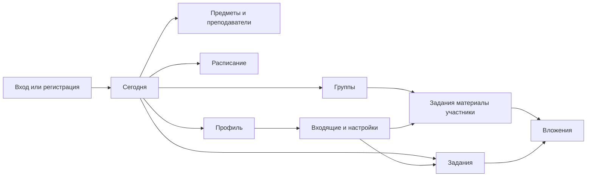

# Интерфейс Android приложения

## Организация макетов

Отдельный [проект UniFlow Android в Figma](https://www.figma.com/design/G5td2BUaPyTcOFqbkGbQQR?node-id=2-324) предназначен для Android-приложения. Страница «01 Дизайн-система Android» содержит цвета, шрифты, размеры и компоненты. Страница «02 Экраны Android» содержит шесть мобильных экранов шириной 390 dp.

Макеты воспроизводят структуру компонентов существующего клиента. Показано полное содержимое прокручиваемых экранов: высота макета зависит от числа карточек. В приложении содержимое прокручивается внутри `ScrollView`, а шапка и нижнее меню находятся в оболочке `AppShell`. Системные области Android учитываются через `SafeAreaView` и не являются элементами дизайн-системы UniFlow.

## Цвета

| Токен | HEX | Назначение |
| --- | --- | --- |
| background | #F5F6FA | Фон экрана |
| surface | #FFFFFF | Карточки и шапка |
| ink | #17223B | Основной текст |
| muted | #737B8E | Пояснения |
| border | #E5E8EF | Границы карточек |
| primary | #6554D9 | Основные действия и активный раздел |
| primarySoft | #EFECFC | Вторичные действия |
| green | #16876C | Успех и выполнение вовремя |
| greenSoft | #E7F5EE | Фон сообщения об успехе |
| danger | #B63E4A | Ошибки и просрочка |
| dangerSoft | #FFF0EF | Фон ошибки |
| amber | #A77522 | Выполнение с опозданием |
| inputBorder | #DCE0E9 | Граница поля |
| placeholder | #989EAE | Подсказка пустого поля |

Цвета взяты из `shared/theme.ts`, `shared/forms.tsx` и `features/tasks/statistics-cards.tsx`. В Figma предусмотрены базовые переменные палитры и семантические переменные с привязками. Используется светлая тема.

## Шрифты и геометрия

В приложении задан системный шрифт Android. В Figma используется Roboto, в локальном предварительном изображении дизайн-системы — Arial с поддержкой кириллицы. Изображения шести экранов экспортированы непосредственно из Figma и используют Roboto. Размеры интерфейса указаны в логических единицах React Native; масштаб макета 1:1 соответствует dp, а размеры текста — базовым sp до пользовательского масштабирования.

| Стиль | Размер и интерлиньяж | Насыщенность |
| --- | --- | --- |
| Title | 30 / 40 | 800 |
| Heading | 18 / 26 | 700 |
| Body | 15 / 24 | 400 |
| Button | 14 / 22 | 700 |
| Label | 13 / 20 | 600 |
| Caption | 12 / 20 | 400 |
| Metric | 29 / 36 | 800 |
| Brand | 21 / 26 | 800 |

Отступы: 4, 6, 8, 10, 12, 13, 14, 16, 18, 20, 24, 26, 32 и 40. Радиусы: 3, 10, 12, 16 и 20. Поля содержимого — 20, высота шапки — 88. Карточка формы имеет отступ 24 и радиус 20. Кнопки и однострочные поля имеют минимальную высоту 46; показатели образуют сетку 2×2.

## Компоненты и состояния

| Компонент | Состав и варианты |
| --- | --- |
| Button | Primary и Secondary; Default, Disabled, Loading; состояние блокирует повторное нажатие и снижает непрозрачность до 0,6 |
| Field | Подпись и поле ввода; email, пароль и часовой пояс используют этот компонент |
| Nav | Активное и обычное состояние; подпись и символ раздела |
| Statistic | Значение, подпись и один из четырёх смысловых цветов |
| Header | Бренд, состояние подключения и переход в профиль или вход |
| Lesson | Время, предмет, преподаватель и аудитория |
| Deadline | Название и ближайший срок |
| Task и GroupTask | Название, описание, срок, выполнение, история, вложения и разрешённые действия |
| Notice | Текст успеха или ошибки |
| EmptyState | Объяснение пустого списка и следующее действие |

Символы разделов соответствуют `app-shell.tsx`. Ошибки сообщаются текстом. Права не определяются цветом или видимостью кнопок: сервер проверяет каждую операцию. Увеличение шрифта средствами Android и доступность всех рабочих форм требуют отдельной проверки на устройстве.

## Мобильные экраны

| Экран | Пользовательский сценарий | Содержание |
| --- | --- | --- |
| 01 Сегодня | UC-06 | Быстрые переходы, личная статистика 2×2, занятия и ближайшие дедлайны |
| 02 Расписание | UC-10–UC-14 | Выбор недели и дня, список пар, отмена и перенос |
| 03 Личные задания | UC-15–UC-20 | Статистика, фильтры по состоянию и предмету, карточки заданий |
| 04 Задания группы | UC-21–UC-30 | Управление группой по роли, вкладки, отдельный общий прогресс и публикация |
| 05 Вход | UC-02 | Email, пароль, вход и переходы к регистрации и восстановлению |
| 06 Профиль | UC-04, UC-05, UC-33–UC-35 | Имя, часовой пояс, выход, настройки и входящие напоминания |

Демонстрационный личный набор содержит 12 заданий: 7 выполнены вовремя, 1 с опозданием и 4 открыты, включая 1 просроченное. Завершено 67%. Общий набор выбранной группы содержит 3 задания и учитывается отдельно.

## Переходы

Нижняя навигация открывает четыре основных раздела. Имя в шапке открывает профиль, а вход после проверки данных — «Сегодня» или сохранённое назначение ссылки. Схема задаёт навигацию приложения. Полный интерактивный прототип не является частью комплекта; алгоритмы операций подробно заданы в Use Case и реализованы в приложении.

## Исходные файлы

[Предварительные изображения и описание сцены](design) включены в самостоятельный комплект. [Код нативного импорта](figma-plugin/code.js) создаёт редактируемые текстовые слои, Auto Layout, компоненты, экземпляры, переменные и стили. Он не выполняет сетевых запросов и не меняет код приложения. Результаты проверки Figma записаны в [figma.json](figma.json). Все шесть экранов экспортированы после исправления ширины полей и просмотрены целиком.
