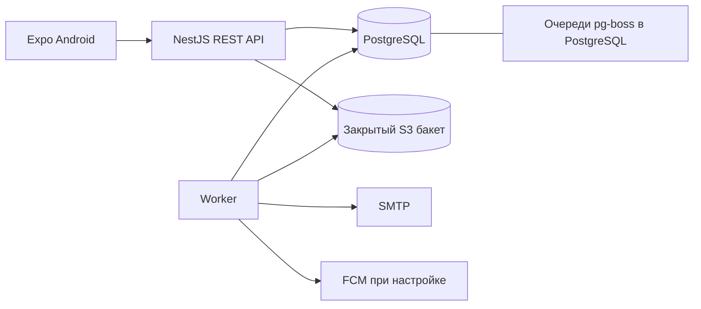

# Техническая архитектура

## Общая структура

UniFlow — монорепозиторий pnpm с Android-клиентом и сервером NestJS. Сервер устроен как модульный монолит. HTTP API и фоновый обработчик имеют разные точки входа и запускаются отдельными процессами; предметная логика и инфраструктурные сервисы у них общие.

Android обращается к `/api/v1`. Клиент не подключается к БД и не получает S3-учётные данные. Байты файлов проходят через сервер после проверки доступа. Постановка фоновой работы через `fromPrisma(tx)` входит в ту же транзакцию PostgreSQL, что и изменение предметных данных.

## Выбор технологий

| Область | Технологии в коде | Обоснование выбора |
| --- | --- | --- |
| Общий язык | TypeScript | Общая типизация клиента, сервера и API-контракта |
| Клиент | React Native, Expo, Expo Router | Мобильные компоненты, навигация и нативные интеграции Android |
| Сервер | NestJS | Модули, внедрение зависимостей, контроллеры, guards и DTO |
| СУБД | PostgreSQL | Связанные данные, внешние ключи, уникальность и транзакционные блокировки |
| Доступ к БД | Prisma | Типизированные запросы, схема и миграции; точечный SQL для блокировок и агрегаций |
| API | REST, Swagger/OpenAPI, openapi-fetch | Явный HTTP-контракт и генерируемые транспортные типы |
| Время | Luxon, IANA time zones | Разделение локального времени повторения и абсолютных моментов |
| Фоновые задачи | pg-boss | Надёжная очередь поверх уже используемой PostgreSQL без отдельного Redis |
| Файлы | S3 API, локально SeaweedFS | Отдельное хранение бинарных данных и закрытый бакет |
| Почта | SMTP, локально Mailpit | Восстановление доступа и удобная проверка писем локально |
| Проверки | TypeScript, ESLint, Prettier, Node tests | Проверки контрактов, логики и серверных интеграций; Android APK проверяется в эмуляторе и на устройстве |

Версии пакетов фиксируют `package.json` и `pnpm-lock.yaml`, версии контейнеров — `infra/compose/compose.yaml`. В исходной конфигурации закреплены Node.js 24, pnpm 11, Expo SDK 58, NestJS 12, Prisma 7 и PostgreSQL 18. Новые зависимости для работы приложения этим проектированием не вводятся.

## Серверные модули

| Реальный модуль | Компоненты и ответственность |
| --- | --- |
| `AuthModule` | `AuthController`, `UsersController`, `AuthService`, `SessionGuard`, ограничение частоты, хеширование, восстановление пароля и профиль |
| `CatalogModule` | Предметы и преподаватели текущего пользователя |
| `ScheduleModule` | Семестры, повторяющиеся пары, календарные вычисления и исключения |
| `TasksModule` | Личные задания, их переходы и история |
| `StatisticsModule` | Контроллер объединяет личные показатели `TasksService` и индивидуальные групповые показатели `GroupTasksService` |
| `GroupsModule` | Группы, роли, членства, приглашения, групповые задания и общий прогресс |
| `FilesModule` | Вложения, проверка доступа, валидация содержимого, очистка и публикации материалов |
| `NotificationsModule` | Настройки, входящие, подписки, ревизии, планировщик и внешние транспорты |
| `InfrastructureModule` | PostgreSQL/Prisma, объектное хранилище, SMTP, конфигурация и очередь |

`HealthController` подключён непосредственно к `AppModule`. Профиль не выделен в самостоятельный `UsersModule`, а материалы не образуют отдельный `MaterialsModule`: это важно при сопоставлении документа с исходниками. Контроллеры разбирают HTTP и DTO, сервисы выполняют предметные правила, инфраструктура скрывает внешние системы.

## Клиентские компоненты

`src/app` содержит маршруты Expo Router. `src/features` группирует функциональность `auth`, `study`, `tasks`, `groups`, `files`, `notifications`. `src/shared` содержит `AppShell`, `Field`, `Button`, `Notice`, `Dialog`, `SelectField`, `EmptyState` и тему. `src/platform` содержит API и реализацию хранения сессии. Нативные интеграции находятся в `session-storage.ts`, `file-transfer.ts`, `notification-device.ts` и `response-handler.tsx`.

`AuthProvider` загружает текущую сессию и предоставляет вход/выход. `RequireSession` закрывает приватные маршруты. `AppShell` отвечает за мобильную шапку, нижнюю навигацию и состояние соединения. За фактическое разрешение запросов отвечает сервер, даже если соответствующая кнопка скрыта клиентом.

`packages/api-client/src/schema.d.ts` генерируется из OpenAPI. Клиент получает транспортные DTO, а не модели Prisma. Это сохраняет границу между публичным контрактом и внутренним хранением данных.

## Алгоритмы предметной области

Для расписания номер недели вычисляется как `floor((date − weekStartDate) / 7 суток) + 1`. Сервер выбирает даты семестра с нужным днём недели и чётностью, затем применяет исключения. Время начала/конца интерпретируется в часовом поясе семестра и выдаётся как абсолютный момент. Клиент отображает его в часовом поясе профиля. Несуществующее локальное время отклоняется; при неоднозначном времени используется более ранний абсолютный момент.

Состояние задания вычисляется из `completedAt`, `dueAt` и `deadlineAtCompletion`. Незавершённое задание с `dueAt < now` просрочено. Завершённое вовремя имеет `completedAt <= deadlineAtCompletion`. Переоткрытие очищает текущую отметку, сохраняя событие в истории. Блокировка строки и запись события выполняются в одной транзакции.

Личная статистика объединяет `Task` и `GroupTask` режима `INDIVIDUAL` из действующих членств. Групповой прогресс считает только `SHARED` выбранной группы. Процент завершения равен округлённому отношению суммы завершённых вовремя и с опозданием к общему числу; при пустом наборе — 0. Поле `open` означает незавершённые, включая просроченные: прибавлять `overdue` к нему для расчёта total нельзя.

Фоновый обработчик сверяет поколение напоминания, текущий срок, выполнение, настройки и членство перед публикацией и доставкой. Уникальные ключи предотвращают дубли в системе; приём сообщения провайдером не доказывает его показ на устройстве.

## Развёртывание и эксплуатация

Локальная инфраструктура поднимается Docker Compose. PostgreSQL хранит предметные таблицы и очереди pg-boss, SeaweedFS — содержимое файлов, Mailpit — локальные письма. Конфигурация валидируется при старте; секреты берутся из окружения. Подписанный Android APK включает JavaScript и подключается к локальному API по инструкции показа.

`GET /api/v1/health/live` проверяет HTTP-процесс, `GET /api/v1/health/ready` — готовность зависимостей. Для каждого запроса назначается `x-request-id`; сервер пишет метод, путь, статус и длительность без тела с паролями. Swagger доступен вне production. HTTPS для публичного размещения обеспечивается окружением развёртывания; наличие локального HTTP не является подтверждением готовности публичного сервера.

## Проверяемость

В репозитории есть модульные тесты паролей, времени, состояний заданий и транспортов; интеграционные — аккаунтов, расписания, заданий, групп, файлов и уведомлений; нативная интеграция проверяется Android APK. Наличие теста не заменяет фактический запуск. Для данной документационной работы выполняется проверка ссылок, структуры и соответствия контракту; прежние результаты разработки не объявляются новыми прогонами.

Основные точки реализации: `apps/server/src/api.ts`, `app.module.ts`, `worker.ts`; `apps/client/src/app/_layout.tsx`; `apps/server/src/modules`; `apps/server/src/infrastructure`; `packages/api-client`. Команды запуска и проверки приведены в [основном README](../../README.md) и [локальной инструкции](../local-demo.md).
