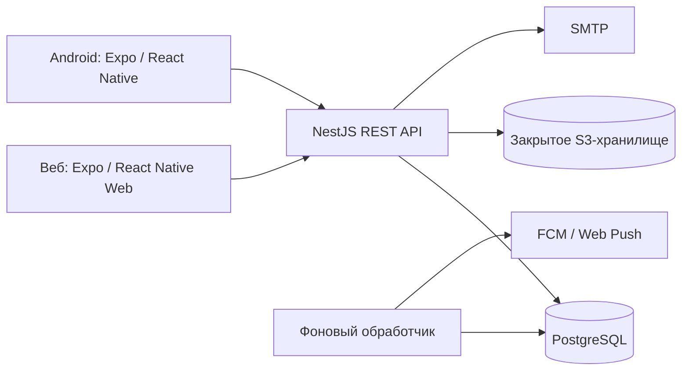

# Архитектура UniFlow

Статус: согласованная архитектура первой версии. Этот документ описывает проектируемое поведение; фактическая готовность отражена в [плане разработки](development-plan.md).

## Границы системы

UniFlow предоставляет веб- и Android-приложение с общим API. Первая версия требует соединения с сервером. Основные данные находятся в PostgreSQL; файлы — в закрытом объектном хранилище. Офлайн-редактирование, синхронизация устройств без сети и автоматическое разрешение конфликтов отложены.

Сервер — модульный монолит NestJS. HTTP API и фоновый обработчик имеют отдельные точки входа и процессы, но используют один серверный проект и общую предметную логику. Это позволяет перезапускать и масштабировать доставку уведомлений отдельно от обработки HTTP-запросов.

Схема показывает логические зависимости. Клиенты передают файлы через API после проверки прав. `pg-boss` хранит задания очереди в PostgreSQL. FCM и Web Push используются при отдельной конфигурации внешней доставки.

## Серверные модули

| Модуль                 | Ответственность                                                                   |
| ---------------------- | --------------------------------------------------------------------------------- |
| `auth`                 | Регистрация без подтверждения почты, вход, выход, восстановление доступа и сессии |
| `users`                | Профиль, часовой пояс и настройки пользователя                                    |
| `subjects` (`catalog`) | Личный справочник предметов                                                       |
| `teachers` (`catalog`) | Личный справочник преподавателей и их контактов; аккаунтов преподавателей нет     |
| `schedule`             | Семестры, шаблоны пар, чётность недель и исключения                               |
| `tasks`                | Личные и групповые задания, режим выполнения и отметки о завершении               |
| `groups`               | Закрытые группы по предметам, участники, роли и приглашения                       |
| `files`                | Метаданные вложений, загрузка, удаление и проверка доступа                        |
| `materials`            | Публикации материалов внутри групп, отдельно от заданий                           |
| `notifications`        | Подписки устройств, настройки напоминаний, планирование и доставка                |
| `statistics`           | Расчёт личного прогресса и отдельных общих показателей                            |

Контроллеры отвечают за HTTP, валидацию и вызов прикладной логики. Изменения данных и правила доступа выполняются в сервисах модулей. Инфраструктурные адаптеры скрывают Prisma, SMTP, S3 API и очередь. Модули обращаются друг к другу через экспортированные сервисы; доступ к чужим данным не должен обходить правила соответствующего модуля.

Это разделение не требует создавать интерфейс или абстрактный репозиторий для каждого запроса. Дополнительные слои вводятся, когда помогают обеспечить границы, тестирование или смену внешнего сервиса.

## Клиент

- `src/app` содержит маршруты Expo Router и сборку экранов.
- `src/features` содержит функции продукта: учётную запись, расписание, задания, группы, материалы и статистику.
- `src/platform` изолирует платформенные различия: хранение сессии, уведомления, выбор файлов и фотографий.
- `src/shared` содержит тему, базовые компоненты, обработку ошибок и общие утилиты.
- `packages/api-client` содержит генерируемый по OpenAPI клиент и транспортные типы. Серверные сущности Prisma, секреты и инфраструктурный код сюда не экспортируются.

Интерфейс адаптируется к ширине экрана. Общий код не означает одинаковую компоновку телефона и компьютера. Кэш сетевых данных допустим для удобства интерфейса, но не считается офлайн-режимом. Изменение считается сохранённым только после успешного ответа сервера; ошибки и состояние отправки видимы пользователю.

## Модель данных

Основные сущности перечислены ниже. Поля и ограничения закреплены в [схеме Prisma](../apps/server/prisma/schema.prisma) и SQL-миграциях.

| Сущность                                                                       | Назначение                                                     |
| ------------------------------------------------------------------------------ | -------------------------------------------------------------- |
| `User`, `Session`                                                              | Учётная запись, профиль и отзываемые сессии                    |
| `ActionToken`                                                                  | Одноразовые токены восстановления                              |
| `Subject`, `Teacher`                                                           | Личные предметы и преподаватели                                |
| `Semester`                                                                     | Границы семестра, начало отсчёта учебных недель и часовой пояс |
| `ScheduleEntry`, `ScheduleException`                                           | Повторяющееся занятие и отмена или перенос на конкретную дату  |
| `Task`, `TaskEvent`                                                            | Личное задание, отметка и история                              |
| `StudyGroup`, `GroupMember`, `GroupInvitation`                                 | Группа по предмету, членство, роль и приглашение               |
| `GroupTask`, `GroupTaskCompletion`, `GroupTaskEvent`                           | Совместное задание, индивидуальные отметки и история           |
| `GroupMaterial`                                                                | Групповая публикация с текстом и вложениями                    |
| `Attachment` и связи вложений                                                  | Метаданные объекта и связь с заданием или материалом           |
| `ReminderPreference`, `ReminderNotice`, `ReminderDelivery`, `PushSubscription` | Настройки, входящие, внешняя доставка и подписка               |

У группы есть собственное название предмета. Участник может связать её со своим личным предметом. Преподаватели и личное расписание автоматически не публикуются в группу.

Идентификаторы не зависят от позиции в списке; записи имеют даты создания и изменения. Изменения связанных данных выполняются транзакционно. API использует пагинацию списков и явные фильтры по предмету, группе, сроку и выполнению.

## Учётные записи и сессии

Регистрация использует email и пароль. Email используется как логин; подтверждение адреса не требуется. После регистрации можно сразу войти. Предусмотрено восстановление доступа. Социальный вход и аккаунты преподавателей в первую версию не входят.

Сервер хранит хеши паролей и проверяет срок действия и отзыв сессий. Одноразовые токены восстановления не хранятся в открытом виде. Ответы восстановления доступа не раскрывают наличие учётной записи.

Веб использует защищённую `HttpOnly` cookie и защиту изменяющих запросов от CSRF. Android хранит учётные данные сессии в системном защищённом хранилище через Expo SecureStore и передаёт их в заголовке авторизации. Точный механизм и сроки жизни закрепляются при реализации `auth`; контракты входа и выхода тестируются для обеих платформ. В браузерный `localStorage` секреты сессии не записываются.

Локальные письма доставляются в Mailpit. Адрес и параметры SMTP задаются переменными окружения.

## Права в группах

Группы закрытые. Для чтения группового задания, материала или вложения необходимо действующее членство. Ссылка или код приглашения позволяют вступить в конкретную группу; они имеют срок действия и могут быть отозваны. Обычный участник не может повысить свою роль.

Владелец управляет ролями и обладает всеми правами модератора. У группы всегда есть владелец; перед его выходом требуется передача владения. Владелец и модераторы могут удалять чужие публикации. Чужую публикацию нельзя редактировать только на основании роли модератора.

Закрыть или вернуть общее задание в работу может действующий участник, который является автором этого задания, модератором или владельцем. Решения о доступе принимает сервер. Права приглашения, исключения и передачи владения описаны в [правилах групп](groups.md).

## Задания и статистика

Личные задания и задания групп хранятся в отдельных моделях `Task` и `GroupTask`. При создании группового задания автор выбирает `INDIVIDUAL` или `SHARED`. Смена режима опубликованного задания запрещена. Личное задание может ссылаться только на предмет владельца.

В индивидуальном режиме отметка уникальна для пары «задание — пользователь». У общего задания есть одна общая отметка, дата завершения и пользователь, выполнивший закрытие. Повторная отправка одного запроса завершения не создаёт дубликатов.

Просрочка — вычисляемое состояние относительно дедлайна, а не отдельный флаг, который нужно периодически обновлять. Личная статистика разделяет завершённые вовремя, завершённые с опозданием и открытые просроченные задания. При завершении сохраняются `completedAt` и действовавший дедлайн; последующая правка дедлайна не переписывает историю завершения.

Завершение и переоткрытие блокируют строку задания в транзакции. Изменение личной отметки и запись `TaskEvent` выполняются атомарно, как и соответствующее действие для `GroupTaskEvent`. Равенство времени завершения и дедлайна считается выполнением вовремя. При удалении личного предмета задания сохраняются без привязки. При удалении личного задания удаляется его история.

Переоткрытие завершённого задания выполняется теми же субъектами, которые могут его закрыть. До повторного завершения оно считается открытым, а статистика пересчитывается. Предыдущее завершение сохраняется в истории изменений, но не учитывается как ещё одно выполненное задание. В индивидуальном режиме переоткрывается только собственная отметка.

Личная статистика учитывает личные задания и индивидуальные групповые задания действующих членств. Общие задания учитываются в прогрессе соответствующей группы. После выхода обе разновидности задач становятся недоступны пользователю, а его прошлые индивидуальные отметки снова учитываются при повторном вступлении. Остальные случаи описаны в [правилах групп](groups.md).

## Расписание

Шаблон занятия содержит день недели, местное время начала и окончания, период действия, чётность учебной недели, предмет, преподавателя и аудиторию. Чётность вычисляется от начала отсчёта учебных недель семестра. Отмена или перенос одной пары сохраняются отдельным исключением; изменение отдельной даты не изменяет весь шаблон.

В базе отдельно хранятся локальное время повторения и IANA-часовой пояс. Для конкретной даты сервер вычисляет абсолютное время занятия с учётом правил часового пояса. Дедлайны задаются абсолютным временем. Правила проверяются тестами границ семестра, перехода суток и смены часового пояса.

## Файлы

Содержимое файлов не хранится в PostgreSQL. Метаданные включают владельца, объектный ключ, тип, размер и состояние загрузки. Бакеты закрытые; загрузка и скачивание требуют проверки прав. Сервер задаёт ограничения размера и допустимых типов, а интерфейс показывает их до отправки.

API проверяет права на родительскую публикацию и передаёт байты из закрытого бакета. При выходе из группы новые скачивания становятся недоступны. Записи незавершённых загрузок, удаления и потери связи обрабатывает worker. Локально используется SeaweedFS с S3 API. [Типы, лимиты и очистка](files.md).

## Уведомления и фоновые задачи

`pg-boss` хранит очередь в PostgreSQL. Изменение данных и постановка работы выполняются одной транзакцией Prisma через `fromPrisma(tx)`.

При планировании worker учитывает получателя, `deadlineRevision` и ревизии настроек, членства и выполнения. Переоткрытие задачи создаёт новое поколение напоминания даже при сохранении дедлайна. Перед публикацией во входящие и внешней доставкой worker повторно проверяет срок, доступ, настройки и поколение задачи.

Повторные попытки обязательны, обработка идемпотентна в пределах системы. Внешние push-сервисы не дают приложению гарантии показа ровно одного уведомления или доставки в точную секунду. Доставка имеет уникальный ключ, ограничение повторов и журнал ошибок; недействительные подписки отключаются.

Локальные входящие и баннер работают через API и отдельный worker. Android также может показать системный баннер в открытом приложении после разрешения. Для закрытого клиента нужны FCM на Android или Web Push с service worker на вебе. [Настройка и правила доставки](notifications.md).

## Разработка и локальный показ

Репозиторий использует pnpm workspace. Общие настройки инструментов находятся в `packages/config`. API публикует OpenAPI-схему, из которой генерируется `packages/api-client`; проверка актуальности контракта включается в CI.

Модульные тесты покрывают правила прав, расписания, выполнения и статистики. Интеграционные тесты используют PostgreSQL и проверяют транзакции и ограничения схемы. Веб-сценарии проверяются Playwright, мобильные интеграции — в Android development build и на устройстве, когда требуется аппаратная функция.

Docker Compose поднимает локальные инфраструктурные сервисы с постоянными томами. Готовую веб-сборку можно запустить без Expo Metro. Подписанный Android APK включает JavaScript и подключается к локальному API через ADB reverse. [Команды запуска и остановки](local-demo.md).

Не входят в первую версию: офлайн-синхронизация, импорт расписания из систем вузов, социальный вход, отдельные аккаунты преподавателей и отдельные нативные клиенты на Kotlin или Swift. iOS не является текущей целевой платформой; возможность общей кодовой базы не считается проверенной поддержкой iOS.
