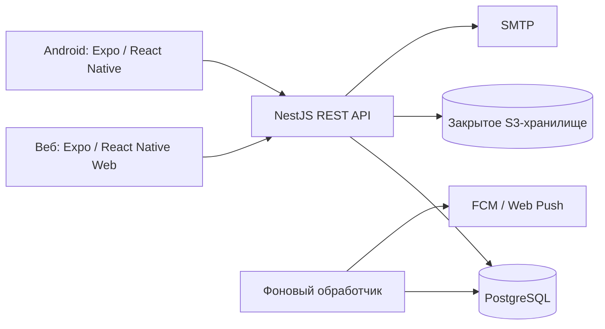

# Архитектура UniFlow

Статус: согласованная архитектура первой версии. Этот документ описывает проектируемое поведение; фактическая готовность отражена в [плане разработки](development-plan.md).

## Границы системы

UniFlow предоставляет веб- и Android-приложение с общим API. Первая версия требует соединения с сервером. Основные данные находятся в PostgreSQL; файлы — в закрытом объектном хранилище. Офлайн-редактирование, синхронизация устройств без сети и автоматическое разрешение конфликтов отложены.

Сервер — модульный монолит NestJS. HTTP API и фоновый обработчик имеют отдельные точки входа и процессы, но используют один серверный проект и общую предметную логику. Это позволяет перезапускать и масштабировать доставку уведомлений отдельно от обработки HTTP-запросов.

Схема показывает логические зависимости. Доступ к файлам может выполняться через API или краткоживущие подписанные ссылки после проверки прав. `pg-boss` хранит задания очереди в PostgreSQL.

## Серверные модули

| Модуль | Ответственность |
| --- | --- |
| `auth` | Регистрация, подтверждение почты, вход, выход, восстановление доступа и сессии |
| `users` | Профиль, часовой пояс и настройки пользователя |
| `subjects` | Личный справочник предметов |
| `teachers` | Личный справочник преподавателей и их контактов; аккаунтов преподавателей нет |
| `schedule` | Семестры, шаблоны пар, чётность недель и исключения |
| `tasks` | Личные и групповые задания, режим выполнения и отметки о завершении |
| `groups` | Закрытые группы по предметам, участники, роли и приглашения |
| `files` | Метаданные вложений, загрузка, удаление и проверка доступа |
| `materials` | Публикации материалов внутри групп, отдельно от заданий |
| `notifications` | Подписки устройств, настройки напоминаний, планирование и доставка |
| `statistics` | Расчёт личного прогресса и отдельных общих показателей |

Контроллеры отвечают за HTTP, валидацию и вызов прикладной логики. Изменения данных и правила доступа выполняются в сервисах модулей. Инфраструктурные адаптеры скрывают Prisma, SMTP, S3 API и очередь. Модули обращаются друг к другу через экспортированные сервисы; доступ к чужим данным не должен обходить правила соответствующего модуля.

Это разделение не требует создавать интерфейс или абстрактный репозиторий для каждого запроса. Дополнительные слои вводятся, когда помогают обеспечить границы, тестирование или смену внешнего сервиса.

## Клиент

- `src/app` содержит маршруты Expo Router и сборку экранов.
- `src/features` содержит функции продукта: учётную запись, расписание, задания, группы, материалы и статистику.
- `src/platform` изолирует платформенные различия: хранение сессии, уведомления, выбор файлов и фотографий.
- `src/shared` содержит тему, базовые компоненты, обработку ошибок и общие утилиты.
- `packages/api-client` содержит генерируемый по OpenAPI клиент и транспортные типы. Серверные сущности Prisma, секреты и инфраструктурный код сюда не экспортируются.

Интерфейс адаптируется к ширине экрана. Общий код не означает одинаковую компоновку телефона и компьютера. Кэш сетевых данных допустим для удобства интерфейса, но не считается офлайн-режимом. Изменение считается сохранённым только после успешного ответа сервера; ошибки и состояние отправки видимы пользователю.

## Модель данных

Начальный набор сущностей:

| Сущность | Назначение |
| --- | --- |
| `User`, `Session` | Учётная запись, профиль и отзываемые сессии |
| `EmailVerificationToken`, `PasswordResetToken` | Одноразовые токены с ограниченным сроком действия |
| `Subject`, `Teacher` | Личные предметы и преподаватели |
| `Semester` | Границы семестра, начало отсчёта учебных недель и часовой пояс |
| `ScheduleEntry`, `ScheduleException` | Повторяющееся занятие и отмена или перенос на конкретную дату |
| `Task`, `TaskCompletion` | Задание и персональная отметка о выполнении |
| `Group`, `GroupMember`, `GroupInvitation` | Группа по предмету, членство, роль и приглашение |
| `Material` | Групповая публикация с текстом и вложениями |
| `Attachment` и связи вложений | Метаданные объекта и связь с заданием или материалом |
| `PushSubscription`, `Reminder`, `NotificationDelivery` | Устройство, правило напоминания и состояние доставки |

Имена предварительные: окончательные поля и ограничения закрепляются миграциями на соответствующем этапе. Для предметов разных участников одной группы не требуется один общий `Subject`: у группы есть собственное название предмета, а участник может связать её со своим личным предметом. Преподаватели и личное расписание автоматически не публикуются в группу.

Идентификаторы не зависят от позиции в списке; записи имеют даты создания и изменения. Изменения связанных данных выполняются транзакционно. API использует пагинацию списков и явные фильтры по предмету, группе, сроку и выполнению.

## Учётные записи и сессии

Регистрация использует email и пароль. Предусмотрены подтверждение почты и восстановление доступа. Социальный вход и аккаунты преподавателей в первую версию не входят.

Сервер хранит хеши паролей и проверяет срок действия и отзыв сессий. Одноразовые токены подтверждения и восстановления не хранятся в открытом виде. Ответы восстановления доступа не раскрывают наличие учётной записи.

Веб использует защищённую `HttpOnly` cookie и защиту изменяющих запросов от CSRF. Android хранит учётные данные сессии в системном защищённом хранилище через Expo SecureStore и передаёт их в заголовке авторизации. Точный механизм и сроки жизни закрепляются при реализации `auth`; контракты входа и выхода тестируются для обеих платформ. В браузерный `localStorage` секреты сессии не записываются.

В локальной среде письма доставляются в Mailpit. В развёрнутом окружении используется внешний SMTP-сервер. Учётные данные задаются переменными окружения.

## Права в группах

Группы закрытые. Для чтения группового задания, материала или вложения необходимо действующее членство. Ссылка или код приглашения позволяют вступить в конкретную группу; они имеют срок действия и могут быть отозваны. Обычный участник не может повысить свою роль.

Владелец управляет ролями и обладает всеми правами модератора. У группы всегда есть владелец; перед его выходом требуется передача владения. Владелец и модераторы могут удалять чужие публикации. Чужую публикацию нельзя редактировать только на основании роли модератора.

Проверка закрытия общего задания: текущий участник группы должен быть автором задания, модератором или владельцем. Бывший участник не сохраняет доступ к общему заданию на основании авторства. Решения о доступе всегда принимает сервер.

## Задания и статистика

Задание имеет область видимости `PERSONAL` или `GROUP`. Групповое задание имеет режим `INDIVIDUAL` или `SHARED`. После публикации режим не меняется в первой версии. Личное задание не может ссылаться на чужой личный предмет.

В индивидуальном режиме отметка уникальна для пары «задание — пользователь». У общего задания есть одна общая отметка, дата завершения и пользователь, выполнивший закрытие. Повторная отправка одного запроса завершения не создаёт дубликатов.

Просрочка — вычисляемое состояние относительно дедлайна, а не отдельный флаг, который нужно периодически обновлять. Личная статистика разделяет завершённые вовремя, завершённые с опозданием и открытые просроченные задания. При завершении сохраняются `completedAt` и действовавший дедлайн; последующая правка дедлайна не переписывает историю завершения.

Переоткрытие завершённого задания выполняется теми же субъектами, которые могут его закрыть. До повторного завершения оно считается открытым, а статистика пересчитывается. Предыдущее завершение сохраняется в истории изменений, но не учитывается как ещё одно выполненное задание. В индивидуальном режиме переоткрывается только собственная отметка.

Общие задания имеют отдельную статистику группы. Их завершение не приписывается каждому участнику как личное достижение. Точные правила удаления и сохранения истории при выходе из группы уточняются до реализации групповых расчётов и покрываются тестами; удаление не должно раскрывать бывшему участнику текущие закрытые материалы.

## Расписание

Шаблон занятия содержит день недели, местное время начала и окончания, период действия, чётность учебной недели, предмет, преподавателя и аудиторию. Чётность вычисляется от начала отсчёта учебных недель семестра. Отмена или перенос одной пары сохраняются отдельным исключением; изменение отдельной даты не изменяет весь шаблон.

В базе отдельно хранятся локальное время повторения и IANA-часовой пояс. Для конкретной даты сервер вычисляет абсолютное время занятия с учётом правил часового пояса. Дедлайны задаются абсолютным временем. Правила проверяются тестами границ семестра, перехода суток и смены часового пояса.

## Файлы

Содержимое файлов не хранится в PostgreSQL. Метаданные включают владельца, объектный ключ, тип, размер и состояние загрузки. Бакеты закрытые; загрузка и скачивание требуют проверки прав. Сервер задаёт ограничения размера и допустимых типов, а интерфейс показывает их до отправки.

Краткоживущая подписанная ссылка выдаётся только после проверки доступа. Сервер не принимает произвольный объектный ключ от клиента как подтверждение права. Незавершённые загрузки и объекты без связей очищаются фоновыми задачами. Отзыв членства блокирует выдачу новых ссылок; уже выданная ссылка ограничена своим коротким сроком действия.

Локально используется SeaweedFS с S3 API. При размещении можно использовать совместимое управляемое хранилище без изменения предметной логики.

## Уведомления и фоновые задачи

`pg-boss` хранит очередь в PostgreSQL. Постановка задания на доставку согласуется с транзакцией изменения данных: уведомление не должно теряться между сохранением задания и созданием работы в очереди. Конкретный способ транзакционной интеграции фиксируется и проверяется при реализации обработчика.

Напоминание связано с заданием, получателем, временем и актуальной версией дедлайна. При выполнении, удалении или переносе задания устаревшая отправка отменяется либо безопасно пропускается обработчиком. Перед отправкой повторно проверяются срок, выполнение, членство и настройки пользователя.

Повторные попытки обязательны, обработка идемпотентна в пределах системы. Внешние push-сервисы не дают приложению гарантии показа ровно одного уведомления или доставки в точную секунду. Доставка имеет уникальный ключ, ограничение повторов и журнал ошибок; недействительные подписки отключаются.

Мобильный транспорт — `expo-notifications` и FCM, веб-транспорт — Web Push через service worker. Серверная бизнес-логика не зависит от выбранного транспорта. Для веб-уведомлений нужны разрешение пользователя и подходящий защищённый контекст. Веб-service worker для получения push не включает офлайн-синхронизацию.

Работа без ключей push в локальной среде явно отмечается как отключённая интеграция. Тестовый транспорт применяется в тестах и не засчитывается как проверенная реальная доставка.

## Разработка, проверки и размещение

Репозиторий использует pnpm workspace. Общие настройки инструментов находятся в `packages/config`. API публикует OpenAPI-схему, из которой генерируется `packages/api-client`; проверка актуальности контракта включается в CI.

Модульные тесты покрывают правила прав, расписания, выполнения и статистики. Интеграционные тесты используют PostgreSQL и проверяют транзакции и ограничения схемы. Веб-сценарии проверяются Playwright, мобильные интеграции — в Android development build и на устройстве, когда требуется аппаратная функция.

Docker Compose поднимает локальные инфраструктурные сервисы с постоянными томами. Для размещения готовятся отдельные конфигурации, HTTPS, управление секретами, health-проверки, структурированные журналы, миграции и резервные копии базы и объектов. Восстановление проверяется практически. Подробная инструкция создаётся вместе с работающими конфигурациями.

Не входят в первую версию: офлайн-синхронизация, импорт расписания из систем вузов, социальный вход, отдельные аккаунты преподавателей и отдельные нативные клиенты на Kotlin или Swift. iOS не является текущей целевой платформой; возможность общей кодовой базы не считается проверенной поддержкой iOS.
