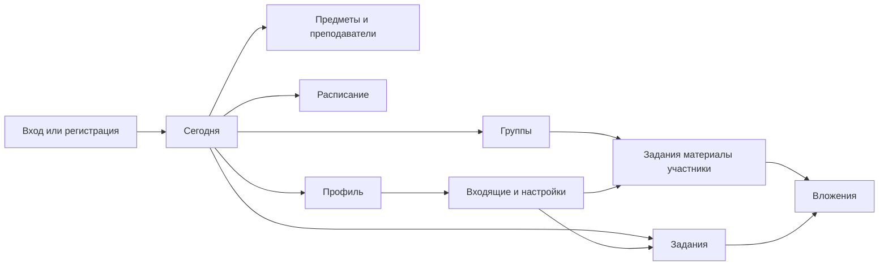

# Интерфейсное проектирование

## Файл Figma

Редактируемый проект: [UniFlow — проектирование интерфейса](https://www.figma.com/design/xhrjwC2FwiIhOd8yTNtP58).

Первая страница [01 Дизайн-система](https://www.figma.com/design/xhrjwC2FwiIhOd8yTNtP58?node-id=2-119) содержит палитру, типографику, размеры, примеры элементов и основные компоненты. Вторая страница [02 Экраны](https://www.figma.com/design/xhrjwC2FwiIhOd8yTNtP58?node-id=4-173) содержит шесть экранов, собранных из экземпляров тех же компонентов. Текст и структура редактируются средствами Figma; макеты не являются вставленными изображениями интерфейса.

## Принципы и навигация

Рабочее пространство имеет четыре основных раздела: «Сегодня», «Расписание», «Задания», «Группы». Ссылка на профиль расположена в шапке. Предметы и преподаватели открываются со страницы дня и из расписания. Вход, регистрация и восстановление доступны без сессии; остальные рабочие маршруты закрывает `RequireSession`.

При ширине от 900 px используется боковая панель 242 px и шапка 88 px. Контент имеет горизонтальные отступы 40 px и максимальную ширину 1280 px. На узком экране меню переходит вниз, отступ контента — 20 px. Расписание по умолчанию открывается неделей на широком экране и днём на узком; пользователь может переключить представление.

В приложении используется системный sans-serif без закреплённого `fontFamily`. На Android это Roboto; в браузере вид зависит от платформы. В Figma выбран доступный Roboto, чтобы явно зафиксировать размеры и начертания для макетов. Добавление собственного шрифта в исходный клиент этим проектированием не предполагается.

## Цвета

| Токен | HEX | Назначение |
| --- | --- | --- |
| `background` | `#F5F6FA` | Фон приложения |
| `surface` | `#FFFFFF` | Карточки, формы, меню, шапка |
| `ink` | `#17223B` | Основной текст и заголовки |
| `muted` | `#737B8E` | Подписи и вторичный текст |
| `border` | `#E5E8EF` | Границы и фон индикатора прогресса |
| `primary` | `#6554D9` | Главное действие, активная навигация и прогресс |
| `primarySoft` | `#EFECFC` | Вторичные кнопки и активный пункт меню |
| `green` | `#16876C` | Успех, выполнено вовремя, соединение |
| `greenSoft` | `#E7F5EE` | Фон сообщения об успехе |
| `danger` | `#B63E4A` | Ошибки и просрочка |
| Дополнительный фон ошибки | `#FFF0EF` | Сообщение об ошибке |
| Дополнительный цвет опоздания | `#A77522` | Выполнено с опозданием |
| Граница поля | `#DCE0E9` | Контур ввода |
| Placeholder | `#989EAE` | Подсказка внутри пустого поля |

Основные десять цветов взяты из `shared/theme.ts`; дополнительные — из `shared/forms.tsx` и `features/tasks/statistics-cards.tsx`. В Figma они представлены примитивами и семантическими алиасами. Текст, заливки, границы, радиусы и отступы компонентов связаны с переменными. В качестве code syntax цветов указан реальный путь `colors.*` для общей React Native-реализации; несуществующие CSS-переменные приложения не заявляются.

## Типографика и размеры

| Роль | Размер и высота строки | Начертание |
| --- | --- | --- |
| Заголовок страницы | 30 / 40 px | 800 |
| Заголовок раздела | 18 / 26 px в макетах | 700 |
| Основной текст | 15 / 24 px | 400 |
| Подпись поля | 13 / 20 px в макетах | 600 |
| Кнопка | 14 / 22 px в макетах | 700 |
| Дополнительная подпись | 12 / 20 px в макетах | 400 |
| Числовой показатель | 29 / 36 px в макетах | 800 |

Высоты строк, отсутствующие в исходном стиле, явно заданы в Figma для воспроизводимого макета. Это спецификация представления, а не утверждение о новом свойстве в коде.

Отступы, встречающиеся в исходных компонентах: 4, 6, 8, 10, 12, 13, 14, 16, 18, 20, 24, 26, 32 и 40 px. Базовая кнопка и поле имеют минимальную высоту 46 px и радиус 10 px. Карточка формы имеет радиус 20 px, внутренний отступ 24 px, границу 1 px. Навигационный элемент — радиус 12 px; статистическая карточка — радиус 16 px и padding 18 px. Индикатор прогресса имеет высоту 6 px и радиус 3 px.

## Библиотека компонентов

| Компонент Figma | Соответствие исходному интерфейсу | Свойства и состояния |
| --- | --- | --- |
| `Button` | `shared/forms.tsx` | `Tone=Primary/Secondary`, `State=Default/Disabled/Loading`, текст `Label` |
| `Field` | `shared/forms.tsx` | Подпись `Label`, значение `Value`, граница и радиус поля |
| `NavItem` | `shared/app-shell.tsx` | Активное/обычное состояние, символ раздела и текст |
| `Statistic` | `statistics-cards.tsx` | Число, подпись, цвет показателя |
| `DeadlineCard` | `today-dashboard.tsx` | Название задания и дедлайн |
| `LessonCard` | `schedule-workspace.tsx` | Время, предмет, преподаватель и аудитория |
| `Notice` | `shared/forms.tsx` | Сообщение об ошибке с текстовым объяснением |
| `TaskCard` | `tasks-workspace.tsx` | Название, метаданные, описание, вложенные экземпляры кнопок |
| `GroupTaskCard` | `group-tasks.tsx` | Режим выполнения, автор, срок и доступные действия |
| `AppShell` | `shared/app-shell.tsx` | Шапка, варианты бокового меню и мобильная навигация |

Загрузка и недоступное действие блокируют повторное нажатие; в исходном компоненте `busy`/`disabled` уменьшают opacity до 0,6, а `busy` показывает индикатор. В Figma состояние загрузки подписано текстом «Сохранение…». Ошибка сопровождается сообщением, пустой список — объяснением следующего действия. Специальные hover- и focus-стили в исходном `Button` не определены и как реализованная часть дизайн-системы не заявляются.

## Спроектированные экраны

| Экран | Ссылка Figma | Сценарии и содержание |
| --- | --- | --- |
| Сегодня | [Web 1440](https://www.figma.com/design/xhrjwC2FwiIhOd8yTNtP58?node-id=4-173) | UC-06, UC-20: сводка дня, статистика, пары, ближайшие сроки, быстрые действия |
| Расписание | [Web 1440](https://www.figma.com/design/xhrjwC2FwiIhOd8yTNtP58?node-id=4-246) | UC-10–14: дневное представление, выбор дня/недели, управление семестрами и парами |
| Личные задания | [Web 1440](https://www.figma.com/design/xhrjwC2FwiIhOd8yTNtP58?node-id=4-337) | UC-15–20: статистика, фильтры, карточки, выполнение, история и вложения |
| Задания группы | [Web 1440](https://www.figma.com/design/xhrjwC2FwiIhOd8yTNtP58?node-id=4-432) | UC-21–30: роль владельца, вкладки, общий прогресс, групповое задание |
| Вход | [Web 1440](https://www.figma.com/design/xhrjwC2FwiIhOd8yTNtP58?node-id=4-524) | UC-02–03: email, пароль, вход, регистрация и восстановление |
| Сегодня на Android | [390 px](https://www.figma.com/design/xhrjwC2FwiIhOd8yTNtP58?node-id=4-572) | UC-06: узкая компоновка, сетка показателей 2×2 и нижняя навигация |

Набор содержит четыре разных рабочих экрана, а также вход и мобильный вариант. В демонстрационных данных 12 личных/индивидуальных заданий: 7 выполнены вовремя, 1 с опозданием, 4 открыты, из которых 1 просрочено; завершение составляет 67%. Три общих задания выбранной группы учитываются отдельно.

## Пользовательские переходы

Схема задаёт переходы интерфейса; автоматический интерактивный прототип Figma не подменяет рабочее приложение. Сервер проверяет доступ при каждом переходе к данным из приглашения или уведомления.

## Проверка макетов

Страницы и все шесть экранов просмотрены после отрисовки Figma. Проверены читаемость, отсутствие непреднамеренного обрезания, соответствие размеров и семейств шрифтов, наличие экземпляров компонентов и привязок цветов. В каждом экране есть редактируемый текст; полноэкранных raster-заливок нет. Локальные PNG в [design](design) служат копиями для отчёта, основным редактируемым результатом остаётся файл Figma. Соответствие требованиям доступности всего работающего приложения требует отдельного пользовательского аудита.
