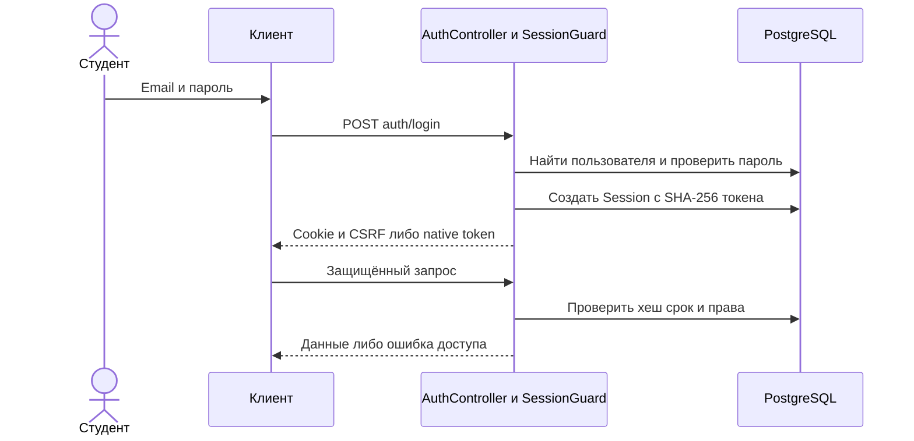

# Аутентификация и авторизация

## Идентификация и пароли

Email используется как логин и нормализуется приведением к нижнему регистру и удалением пробелов по краям. При регистрации сервер проверяет уникальность email, имя 2–80 символов, пароль 12–128 символов и существование IANA-часового пояса. Подтверждение владения email в текущей версии не требуется.

Пароль хранится в формате `scrypt-v1`: случайная соль 16 байт, результат 64 байта, параметры `N=32768`, `r=8`, `p=3`, `maxmem=64 МиБ`. Сравнение результата использует `timingSafeEqual`. При входе с неизвестным email также выполняется вычисление scrypt с фиктивным хешем; сообщение одинаково для неверного пароля и отсутствующего аккаунта.

## Жизненный цикл сессии

1. После проверки пароля сервер генерирует 32 случайных байта и кодирует их base64url в токен длиной 43 символа.
2. В `Session` записывается только SHA-256 токена и срок действия 30 дней. Это непрозрачная серверная сессия, а не JWT; refresh-токенов нет.
3. Для веба сервер устанавливает `uniflow_session`: `HttpOnly`, `SameSite=Lax`, `Path=/`, `Secure` в production. Токен сессии не выдаётся браузерному JavaScript.
4. Клиент Android указывает `x-uniflow-client: native`, получает токен только при входе, сохраняет через Expo SecureStore и отправляет `Authorization: Bearer <token>`.
5. На каждом защищённом запросе `SessionGuard` вычисляет хеш предъявленного токена, ищет сессию, проверяет срок и загружает пользователя. Значение `userId` в клиентском запросе не заменяет эту проверку.
6. Выход удаляет текущую сессию. Истечение срока либо сброс пароля делают её недействительной; парольный сброс удаляет все сессии аккаунта.

Секрет веб-сессии не хранится в `localStorage`. CSRF-токен хранится в памяти и восстанавливается через `GET /auth/session`. Токен Android предназначен только для защищённого хранилища устройства. Использование непрозрачного токена позволяет немедленно отзывать серверные сессии.

## Защита веб-запросов

Для cookie-сессии изменяющие методы проверяют одновременно допустимый `Origin` и заголовок `x-csrf-token`. Ожидаемое значение CSRF — HMAC-SHA256 от константы `uniflow-csrf` с токеном сессии в качестве ключа; сравнение выполняется безопасной функцией. Методы `GET`, `HEAD`, `OPTIONS` не изменяют предметные данные. Bearer-запросы не используют cookie-механизм CSRF.

Публичные операции аккаунта принимают JSON и проверяют присутствующий Origin. CORS разрешает только настроенный веб-origin и его loopback-вариант; credentialed-запросы разрешены для этих адресов. Helmet устанавливает защитные HTTP-заголовки. Эти механизмы не заменяют серверные предметные проверки.

## Восстановление пароля и ограничения попыток

Ответ запроса восстановления не раскрывает существование аккаунта. Для существующего пользователя отправка письма ставится в pg-boss. Worker генерирует одноразовый секрет на 30 минут, сохраняет его SHA-256 и инвалидирует прежние неиспользованные токены того же назначения.

Погашение проверяет назначение, срок и `usedAt`. Транзакционное условное обновление допускает только одно использование; затем меняется хеш пароля, удаляются все сессии и погашаются остальные токены восстановления. Секрет ссылки не включается в технический журнал тела запроса.

Публичные операции аккаунта ограничены общим пределом 100 запросов на IP за 900 секунд. Дополнительно для пары «вид операции — IP — email» действует 10 попыток входа или 5 прочих операций за то же окно; при сбросе ключ формируется без email. Ограничения сохраняются в PostgreSQL, поэтому не сводятся к памяти одного процесса. Принятие приглашений имеет отдельное ограничение попыток по аккаунту.

## Авторизация

Личные предметы, преподаватели, семестры, пары и задания выбираются с ограничением по пользователю из сессии. Доступ к группе требует действующего членства и отсутствия архива. После этого сервис проверяет роль и авторство операции. Владелец вычисляется из `ownerId`, роли остальных участников хранятся в членстве.

| Действие в группе | Участник | Модератор | Владелец |
| --- | --- | --- | --- |
| Читать задания материалы и список действующих участников | Да | Да | Да |
| Публиковать задания и материалы | Да | Да | Да |
| Изменять текст публикации | Только своей | Только своей | Только своей |
| Удалять публикацию | Только свою | Любую | Любую |
| Ставить индивидуальную отметку | Только свою | Только свою | Только свою |
| Закрывать и переоткрывать общее задание | Если автор | Да | Да |
| Создавать приглашения | Нет | Да | Да |
| Отзывать приглашения | Нет | Только свои | Любые |
| Исключать пользователей | Нет | Только обычных участников | Участников и модераторов |
| Менять роли снимать блокировку передавать владение | Нет | Нет | Да |
| Менять настройки и архивировать группу | Нет | Нет | Да |
| Добавлять и удалять отдельные групповые вложения | Если автор публикации | Если автор публикации | Если автор публикации |

Последняя строка отличается от удаления всей публикации: модерация разрешает удалить чужой материал/задание целиком, но не менять набор чужих вложений. Действующее членство необходимо даже автору. Участник, покинувший группу, не продолжает управлять публикациями по старому идентификатору.

Для недоступных личных и групповых ресурсов сервис может отвечать `404`, скрывая существование записи; `403` применяется к запрещённому действию, когда ресурс уже доступен. Интерфейс использует возвращённые признаки возможностей, но скрытие кнопки не является механизмом безопасности.

## Файлы и уведомления

Бакет закрыт. Сервер заново проверяет родительский ресурс при списке, загрузке, скачивании и удалении. Клиент не получает постоянный публичный URL объекта или ключи S3. MIME определяется содержимым, разрешены PDF, TXT UTF-8, JPEG, PNG и WebP. Ограничены размер, число вложений и пользовательская квота. Выдача выполняется как attachment с безопасным именем и защитными заголовками; проверка сигнатуры не заявляется антивирусным сканированием.

Подписка внешних уведомлений связана с пользователем и сессией. Перед отправкой проверяются срок/отзыв сессии, членство, настройки, состояние задания и поколение. Истёкшие адреса отключаются. Входящие с утраченным доступом скрываются. Разрешение на системные уведомления пользователь выдаёт средствами ОС или браузера.

## Конфигурация и обработка ошибок

Секреты БД, SMTP, S3, FCM и Web Push задаются окружением и не публикуются в `EXPO_PUBLIC_*`. Валидация DTO использует whitelist, запрет неизвестных полей и преобразование типов. Фильтр ошибок возвращает `error.code`, безопасное `error.message` и `requestId`; внутренний стек и реквизиты подключения клиенту не выдаются. PostgreSQL ограничивает уникальность и связи независимо от клиентской формы.

Описанные механизмы присутствуют в коде. Тестирование реальных внешних push-провайдеров, аудит клавиатурной доступности, нагрузочные измерения и настройка публичной инфраструктуры требуют самостоятельных проверок и не подменяются этим документом.

Источники: `modules/auth/password.ts`, `tokens.ts`, `session.guard.ts`, `auth.service.ts`, `auth-mail.service.ts`, `rate-limit.service.ts`, `modules/groups/groups.service.ts`, `modules/files/attachment-access.service.ts`, `api.ts`, `common/api-error.ts`.
