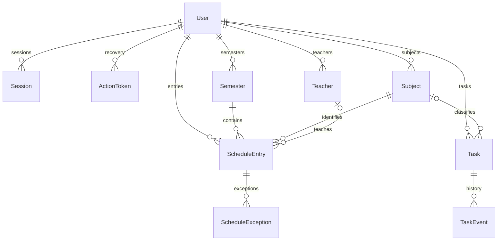
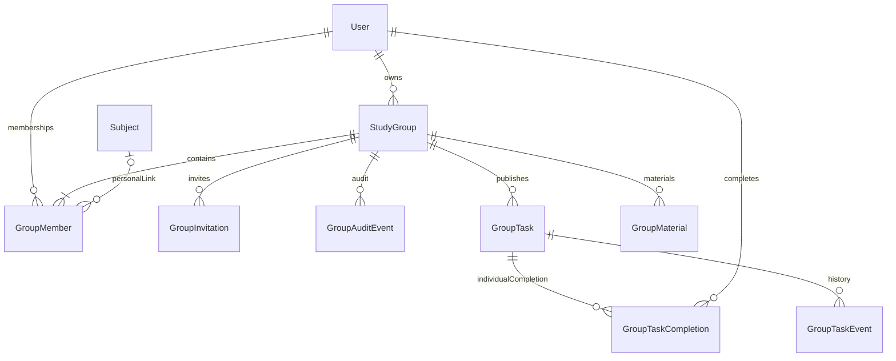
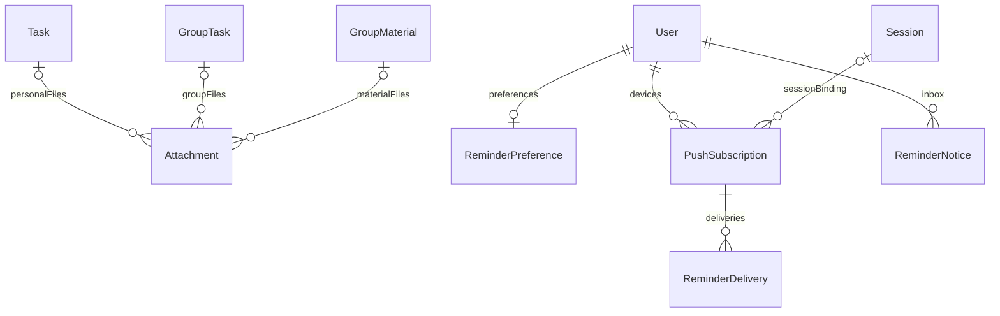

# Проектирование базы данных

## СУБД и организация хранения

Основная СУБД — PostgreSQL. Реляционная модель подходит UniFlow, поскольку расписание, авторство, членство и отметки выполнения связаны внешними ключами, а права и переходы состояния требуют согласованных транзакций. Схема задаётся Prisma, изменения применяются SQL-миграциями. Бинарные файлы хранятся в S3, в PostgreSQL остаются метаданные и ссылки на родительскую публикацию.

Большинство сущностей имеет UUID. Абсолютные моменты используют `timestamptz(3)`, календарные даты — `date`, локальное время повторяющейся пары — строку `HH:mm` совместно с IANA-часовым поясом семестра. Не все таблицы имеют `createdAt` и `updatedAt`: точный состав полей следует схеме, а не единому условному шаблону.

## Учётная запись и личное планирование

| Модель и таблица | Ключевые поля | Ограничения и назначение |
| --- | --- | --- |
| `User` / `users` | `id`, `email`, `passwordHash`, `displayName`, `timeZone` | Уникальный email; профиль и хеш пароля |
| `Session` / `sessions` | `id`, `userId`, `tokenHash`, `expiresAt` | Уникальный SHA-256 токена; индексы пользователя и срока |
| `ActionToken` / `action_tokens` | `id`, `userId`, `purpose`, `tokenHash`, `expiresAt`, `usedAt` | Одноразовый токен восстановления; уникальный хеш |
| `AuthRateLimit` / `auth_rate_limits` | `key`, `count`, `windowEndsAt` | Серверные счётчики ограничения попыток |
| `Subject` / `subjects` | `id`, `userId`, `name`, `color` | Личный предмет; индекс `(userId, name)` не означает уникальность названия |
| `Teacher` / `teachers` | `id`, `userId`, `name`, `email?`, `phone?`, `notes?` | Личная контактная запись без аккаунта |
| `Semester` / `semesters` | `id`, `userId`, `name`, `startDate`, `endDate`, `weekStartDate`, `timeZone` | Период и начало отсчёта учебных недель |
| `ScheduleEntry` / `schedule_entries` | `id`, `userId`, `semesterId`, `subjectId`, `teacherId?`, `dayOfWeek`, `startTime`, `endTime`, `parity`, `room?` | Повторение пары; `parity`: `ALL`, `EVEN`, `ODD` |
| `ScheduleException` / `schedule_exceptions` | `id`, `entryId`, `originalDate`, `cancelled`, `replacementDate?`, `startTime?`, `endTime?` | Уникально `(entryId, originalDate)`: одно исключение для исходного занятия |
| `Task` / `tasks` | `id`, `userId`, `subjectId?`, `title`, `description`, `dueAt`, `deadlineRevision`, `completedAt?`, `deadlineAtCompletion?` | Личное задание; индексы `(userId, dueAt, id)` и `(userId, completedAt)` |
| `TaskEvent` / `task_events` | `id`, `taskId`, `kind`, `createdAt`, `deadlineSnapshot` | `COMPLETED`/`REOPENED`, история переходов |

### Связи личных данных

У записи расписания обязательны семестр и предмет; преподаватель необязателен. Для задания предмет необязателен. При удалении предмета задания сохраняются с `subjectId = null`, но удаление используемого в расписании предмета блокируется `Restrict`. Удаление преподавателя обнуляет ссылки на него. Удаление семестра каскадно удаляет пары и исключения; удаление задания — его события.

## Групповая работа

| Модель и таблица | Ключевые поля | Ограничения и назначение |
| --- | --- | --- |
| `StudyGroup` / `study_groups` | `id`, `ownerId`, `name`, `subjectName`, `description`, `archivedAt?` | Владелец задаётся отдельно от роли членства |
| `GroupMember` / `group_members` | `groupId`, `userId`, `role`, `subjectId?`, `joinedAt`, `leftAt?`, `blockedAt?` | Составной PK `(groupId, userId)`; роль `MEMBER`/`MODERATOR` |
| `GroupInvitation` / `group_invitations` | `id`, `groupId`, `creatorId?`, `tokenHash`, `expiresAt`, `revokedAt?`, `maxUses`, `uses` | Уникальный хеш секрета и лимит вступлений |
| `GroupAuditEvent` / `group_audit_events` | `id`, `groupId`, `actorId?`, `targetUserId?`, `kind`, `createdAt` | История управления группой; `targetUserId` не объявлен внешним ключом |
| `GroupTask` / `group_tasks` | `id`, `groupId`, `authorId?`, `mode`, `title`, `description`, `dueAt`, `deadlineRevision`, `completedAt?`, `deadlineAtCompletion?`, `completedById?`, `deletedAt?` | Режим `INDIVIDUAL`/`SHARED`; общее состояние хранится здесь |
| `GroupTaskCompletion` / `group_task_completions` | `taskId`, `userId`, `completedAt`, `deadlineAtCompletion` | Составной PK `(taskId, userId)` исключает дубли индивидуальных отметок |
| `GroupTaskEvent` / `group_task_events` | `id`, `taskId`, `actorId?`, `kind`, `createdAt`, `deadlineSnapshot` | История общего либо индивидуального выполнения |
| `GroupMaterial` / `group_materials` | `id`, `groupId`, `authorId?`, `title`, `description`, `createdAt`, `updatedAt` | Публикация материала без срока и отметки выполнения |

### Связи групповых данных

Роль `OWNER` вычисляется при выдаче API из `StudyGroup.ownerId`; в enum `GroupMemberRole` её нет. Отложенный составной внешний ключ владельца на `(groupId, userId)` закреплён миграцией, позволяющей транзакционно создать группу вместе с членством и передать владение. Активность членства и соответствие роли проверяет сервис под блокировкой строки группы.

Добровольный выход и исключение сохраняют запись членства, отметки и авторство, но закрывают доступ. Архивирование записывает `archivedAt`, удаление группового задания — `deletedAt`; это мягкое удаление. Публикации и отметки не выдаются пользователю после прекращения доступа.

## Вложения и напоминания

| Модель и таблица | Ключевые поля | Назначение |
| --- | --- | --- |
| `Attachment` / `attachments` | `id`, `uploaderId?`, `taskId?`, `groupTaskId?`, `materialId?`, `objectKey`, `name`, `mimeType`, `size`, `state`, `createdAt` | Метаданные файла; уникальный случайный объектный ключ |
| `ReminderPreference` / `reminder_preferences` | `userId`, `enabled`, `minutesBefore` | Одна настройка на пользователя, по умолчанию выключена и 60 минут |
| `PushSubscription` / `push_subscriptions` | `id`, `userId`, `sessionId?`, `transport`, `fingerprint`, `address`, `p256dh?`, `authSecret?`, `revokedAt?` | Уникальный fingerprint адреса; `WEB`/`ANDROID` |
| `ReminderRevision` / `reminder_revisions` | `key`, `version`, `updatedAt` | Ревизии областей, из которых вычисляется поколение |
| `ReminderNotice` / `reminder_notices` | `id`, `userId`, `kind`, `taskId`, `groupId?`, `generation`, `scheduledAt`, `createdAt?`, `readAt?` | Уникально `(userId, kind, taskId, generation)` |
| `ReminderDelivery` / `reminder_deliveries` | `id`, `subscriptionId`, `userId`, `kind`, `taskId`, `generation`, `scheduledAt`, `status`, `attempts`, `lastResult?` | Уникально `(subscriptionId, kind, taskId, generation)`; журнал внешней доставки |
| `JobProbe` / `job_probes` | `id`, `createdAt`, `completedAt?` | Служебная проверка отдельного worker, не пользовательская сущность |

Доступное вложение связано ровно с одним из трёх видов родителя. SQL-ограничение разрешает не более одного родителя, а прикладная проверка требует существующую доступную публикацию при загрузке. Ноль ссылок допустим после удаления родителя для последующей очистки. `PENDING` означает незавершённую загрузку, `READY` — доступный файл, `DELETING` — скрытый файл, ожидающий очистки. При удалении родителя ссылки обнуляются, чтобы worker мог удалить объект по сохранившимся метаданным.

`ReminderNotice.taskId` и `ReminderDelivery.taskId` — полиморфные ссылки: вид задания задаёт `kind`, прямого FK на `Task`/`GroupTask` нет. Аналогично `groupId` во входящих не объявлен отношением Prisma. Наличие задания и права повторно проверяет обработчик. Диаграмма показывает только объявленные связи, а не предполагаемые внешние ключи.

## Целостность и параллельные изменения

Уникальные ключи исключают повторную индивидуальную отметку, два исключения одной пары на дату и повтор одного поколения напоминания. Сервисные транзакции блокируют строку группы/задания при изменении прав и состояния. Создание события, изменение состояния и постановка связанных фоновых работ фиксируются атомарно. Индексы соответствуют владельцу, группе, сроку, состоянию и времени истории; утверждение о достаточной производительности на больших объёмах требует отдельного замера.

Источники: [полная схема Prisma](https://github.com/etorusl/uniflow/blob/b6d61e7053c5a9eaf3bb4b71f9989711fac3ba87/apps/server/prisma/schema.prisma) и [каталог миграций](https://github.com/etorusl/uniflow/blob/b6d61e7053c5a9eaf3bb4b71f9989711fac3ba87/apps/server/prisma/migrations). Словарь выше перечисляет все модели схемы; таблицы pg-boss создаются механизмом очереди отдельно.
